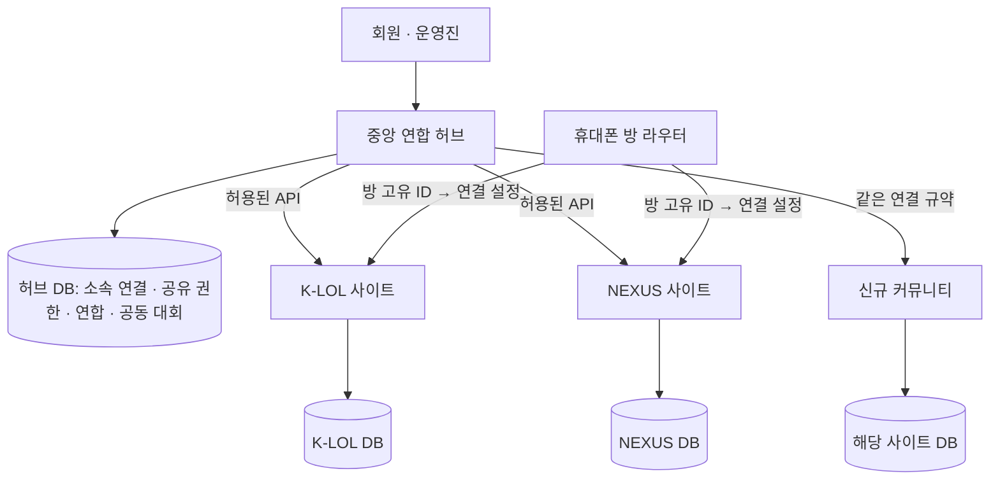

# 커뮤니티 연합 허브 실행 계획

결정일: 2026-10-29 · 결정 근거: 사용자가 설계 선택과 단계별 진행을 위임했다.

## 선택한 구조

**독립된 중앙 사이트·DB와, 기존 사이트가 자기 자료를 소유하는 연합 구조를 채택한다.** 중앙 서비스는 커뮤니티 탐색·내 소속·연합·공동 대회의 접점이다. K-LOL/NEXUS의 회원·모집·경기 원본은 각각의 DB에 남는다. 공유는 항목별 권한과 만료 기간을 가진 API로 수행한다.

중앙 코드도 현재 Next.js/Drizzle 기반을 재사용한다. 처음부터 마이크로서비스나 별도 메시지 브로커를 도입하지 않는다. 하나의 모듈형 앱과 별도 PostgreSQL DB, 트랜잭션 outbox/재시도 작업으로 시작하고 실제 처리량·장애 근거가 있을 때 분리한다. 중앙 장애 때문에 기존 사이트에서 모집·내전·봇 명령을 처리하지 못하는 구조를 피한다.

단순한 명단 합치기는 계정 충돌, 방 오발송, 권한 누출을 만든다. 독립 운영을 보존하면서 기능별로 연결하는 것이 현재 요구에 맞다. 가입 커뮤니티 모아보기와 통합 로그인은 구분하며, 초기에는 각 계정의 로그인으로 연결을 확인한다.

## 사용자에게 제공할 공간

| 공간 | 제공할 기능 | 기본 공개 범위 |
|---|---|---|
| 내 커뮤니티 | 본인이 연결·확인한 가입 사이트, 소속별 역할, 빠른 이동 | 본인 |
| 커뮤니티 탐색 | 소개, 활동 종류, 모집 여부, 승인된 방문 링크 | 공개 등록 항목 |
| 회원 교류 | 참여한 연합의 게시판·모집, 교류전 신청·관람 | 참여 범위에 따른 공개 |
| 운영진 공간 | 연합 제안, 공동 일정·운영 공지, 공유 요청과 승인 | 해당 커뮤니티 운영진 |
| 공동 대회 | 커뮤니티/방 대표팀, 참가자격, 대진·일정·결과, 이의 처리 | 대회별 설정 |
| 운영 기록 | 검토된 사건의 출처·상태·유효기간·정정, 제한된 증거 접근 | 승인된 담당자만 |

공개 목록에 있다는 것은 회원 가입·운영 신뢰 보증·실시간 연결을 뜻하지 않는다. 운영 기록이 없다는 것도 안전 판정으로 표시하지 않는다. 닉네임·소환사명 일치만으로 같은 사람으로 병합하거나 위험 점수를 자동 생성하지 않는다. 본인 확인된 계정 연결과 범위가 명시된 사건 기록을 근거로 운영진이 판단한다.

## 통합과 분리의 규칙

공유 단위는 `커뮤니티 × 데이터 종류 × 대상 × 허용 행동 × 유효 기간`이다. 연합 가입만으로 자료 접근권이 생기지 않는다.

| 정보 | 기본값 | 통합을 선택했을 때 |
|---|---|---|
| 공개 소개 | 비공개 초안 | 운영자가 공개한 필드만 탐색 목록 표시 |
| 회원 소속 | 본인만 | 본인이 연결한 계정의 소속만 내 화면에 표시 |
| 모집 | 커뮤니티별 분리 | 같은 커뮤니티의 공유 그룹, 또는 별도 승인된 연합 모집으로 게시 |
| 경기 결과 | 원본 사이트 소유 | 공동 대회가 명시적으로 채택한 결과만 수신 |
| MMR·랭킹 | 사이트별 유지 | 교차 보정 검증 전 공통 순위로 합산하지 않음 |
| 운영 기록·증거 | 공유 안 함 | 사건 요약/증거 권한을 별도로 승인하고 만료·철회·정정 전파 |

외부로 보내는 정보는 허용 필드 목록으로 만든 DTO만 사용한다. 원본 DB 접속 정보, 비밀번호, 세션 쿠키, 비공개 메모를 중앙에 복제하지 않는다. 연결 철회는 새 요청·캐시·대기 중 발송에도 반영한다.

## 동적 카카오톡 방

1. 커뮤니티당 대화방/구인구직방을 쉽게 추가하되 개수는 고정하지 않는다. 대회방·공지방도 같은 모델을 쓴다.
2. 방 이름은 표시용이다. 실제 식별은 검증한 `(기기 설치 ID, Android 사용자, 플랫폼 방 식별자)` 조합을 사용한다. 큰 정수 식별자는 문자열로 보존한다.
3. 같은 커뮤니티에서 같은 `dataGroupKey`를 선택한 방은 모집 공유 대상이 될 수 있다. 다른 커뮤니티에서 같은 문자열을 써도 자동으로 연결되지 않는다.
4. 신규 방 등록 → 일회용 연결 코드 발급 → 해당 방 수신 확인 → 고유 ID 중복 검사 → 관리자가 연결 결과 확인 → 서명된 설정 배포 순서로 활성화한다.
5. 휴대폰은 버전·서명·유효기간·대상 기기를 검증한 전체 설정을 원자적으로 교체한다. 잘못된 새 설정은 적용하지 않는다. 유효한 마지막 설정과 적용 상태를 보관한다.
6. 자동 알림의 중복 키에는 `이벤트 ID + 대상 방 ID`가 포함된다. 수신 세션이 만료되면 재연결 대상으로 표시하고 다른 방으로 대체 발송하지 않는다.
7. 기존 R32/companion/router를 유지한 채 신규 gateway를 별도 시험 기기/방에서 검증한다. 검증 후 방별 이관하고 구동 프로필 중복을 차단한다.

현재 관리 한도는 커뮤니티 100개·방 500개이며 폰의 실제 처리 용량을 보장하는 수치가 아니다. 방 추가 때마다 소스 수정·프로필 복제를 요구하지 않는 것이 완료 기준이다.

## 1차 구현: 등록·관리 기반

현재 작업 트리에 구현한 범위다. 검증 근거는 [QA 문서](../qa-evidence/community-network-2026-10-29/README.md)에 기록한다.

- `/admin/community-network`: 최고 관리자용 사이트/방 추가·편집·보관, 공유 그룹 지정, 저장 충돌 안내.
- `/community-network`: 공개로 지정한 소개와 사이트 링크만 표시하는 목록.
- `/api/admin/community-network`: 기존 로그인·SUPER_ADMIN 권한, 동일 출처 변경 요청, 버전 조건, 멱등성, 트랜잭션 감사 기록.
- `community_network` 스키마: 등록 상태·커뮤니티·방·명령 영수증. migration `0050_community-network-registry`는 기존 자료를 변경하지 않는 추가형 migration이다.
- 기본 OFF인 `COMMUNITY_NETWORK_ENABLED=true`로 제한적으로 활성화한다. 기존 사이트의 런타임 DB 선택·폰 코드는 변경하지 않았다.
- 현재 상태는 `UNVERIFIED`/`NOT_APPLIED`로 고정한다. 등록만으로 사이트 API 접속, 계정 연결, 폰 라우팅 완료를 표시하지 않는다.

**1차 배포는 이 관리 모듈을 NEXUS 안에서 활성화했다. 이는 사용자가 원한 독립 중앙 사이트를 충족하지 못했다.** 공개 탐색 목록은 가입한 사이트 목록과 다르다.

## 정정: 독립 중앙 서비스 GG HUB

사용자는 K-LOL/NEXUS와 같은 사이트가 계속 늘어나고 이를 관리하는 별도 상위 사이트를 요구했다. 이에 `hub` 서비스 런타임을 추가하고 별도 Vercel 프로젝트·Neon DB·로그인·홈·관리 셸을 구성한다. 같은 코드 재사용은 배포나 DB 통합을 뜻하지 않는다.

- 중앙: `https://gg-community-hub.vercel.app`, Vercel `gg-community-hub`, Neon `GG-HUB`, DB `gg_hub`.
- 중앙 DB URL이 없으면 오류로 중단한다. K-LOL/NEXUS DB와 같은 대상도 거부한다.
- 중앙 세션은 독립 키·쿠키·JWT 발급자를 사용하며 기존 사이트 로그인이 중앙 권한을 부여하지 않는다.
- 중앙의 게임·모집·카카오·자식 사이트 관리 API는 허용하지 않는다.
- 사이트·방의 초기 등록 정보만 구성한다. 회원·모집·경기·MMR은 원본 사이트에 남는다.
- 기존 NEXUS에 있던 빈 등록 기능은 독립 중앙 사이트가 검증된 뒤 비활성화한다.

구현·검증·배포 상태는 [독립 허브 QA](../qa-evidence/gg-hub-2026-10-29/README.md), 실행 방법은 [운영 문서](../operations/gg-hub.md)를 따른다. 이 단계에서도 원격 사이트 API 인증, 실제 회원 연결, 폰의 동적 설정 배포는 아직 구현하지 않았다.

## 후속 구축 순서와 완료 기준

| 순서 | 구현 | 완료 기준 |
|---|---|---|
| 2. 독립 허브·연결 인증 | 별도 Vercel 프로젝트/Neon DB, 허브 전용 설정·쿠키·최초 관리자, 사이트 소유자 초대와 설치 승인 | 기존 DB와 대상 불일치 검증, 연결별 제한된 키, 철회 즉시 차단, 원격 주소 검증·SSRF 방어 |
| 3. 내 소속·동적 봇 | 양쪽 로그인으로 계정 연결, 내 가입 사이트, 설정 배포·방 연결·기기 상태 | 같은 닉네임 별개 계정 유지, 3·10·12번째 방 추가에 코드 변경 없음, 기존 네 방 회귀 통과 |
| 4. 선택적 모집·연합 | 공유 권한 승인/철회, 모집 공유, 초대·수락·탈퇴, 공동 게시판 | 한쪽 동의만으로 비공개 자료 유출 없음, 중복 신청 원본 처리, 캐시/대기 작업 철회 반영 |
| 5. 공동 대회 1개 흐름 | 2개 커뮤니티 친선전 → 다팀 대회, 대표 소속·중복 출전·예비 선수·대진·결과 | 참가→마감→편성→결과 확정→정정 전체 흐름 검증, 산식/명단 버전 고정 |
| 6. 운영 기록 교류 | 검토된 사건 공유, 출처/상태/기간, 증거 접근, 이의·정정·조회 감사 | 타 커뮤니티 접근 차단, 취소/정정 전파, 미확정 신고와 확정 조치 구분 |
| 7. 운영 규모 확대 | 재시도 작업·기기 교체·장애 알림·운영 대시보드 | 중앙 장애 중 독립 운영, 중복 발송 방지, 설정 복구와 재연결 실기기 검증 |

중앙 서비스 이름은 ‘GG HUB’로 정했다. 최초 운영자는 사용자가 지정했던 재현(`sjh1148`)의 독립 중앙 계정으로 초기화하고 별도 임시 비밀번호를 사용한다. 기존 계정 비밀번호를 복사하지 않는다. 가상의 운영자/공유 동의/대회를 만들지 않는다.

## 대회·MMR 변경 방침

현재 확인한 세 가지 기능 오류와 표본 표시를 먼저 수정한다. 상세 재현·산식 실험·개선 목록은 [대회 밸런스·MMR 감사](drafts/balance-mmr-audit-2026-10-29.md)에 정리한다.

차기 산식은 **팀 승패를 중심으로 실력 추정과 불확실성을 분리**한다. 티어는 초기 추정에 제한적으로 사용하고, 적은 표본의 포지션 값은 종합 값 쪽으로 보정한다. KDA를 주 점수에 바로 더하지 않는다. 장기 미참여는 실력 벌점보다 불확실성 증가로 다룬다. 이는 설계 선택이며 새 공식의 운영 적용을 의미하지 않는다.

과거→미래 순서의 검증 데이터에서 기존 공식·승패 기준선·후보 산식을 비교한다. Log loss/Brier/보정 오차와 포지션·신규 선수별 오차, 편성 소요 시간, 경기 묶음 입력의 영향을 측정한다. 운영 결과와 나란히 계산하는 shadow 단계, 선수별 변경 미리보기, 대회별 공식 버전 고정과 원장 기반 복구를 통과한 뒤 새 시즌 적용을 결정한다. 기존 점수 일괄 재계산은 이번 단계에 포함하지 않는다.

## 이번 단계의 경계

소스 구현·격리 DB·로컬 화면 검증과 운영 반영은 별개로 기록한다. 1차 기능의 검증을 완료한 후 Git tag와 QA 근거를 남긴다. 운영 migration/환경변수 활성화/새 중앙 배포/폰 교체는 별도 배포 단위로 수행한다. 이 문서만으로 후속 단계가 완성됐다고 표시하지 않는다.
