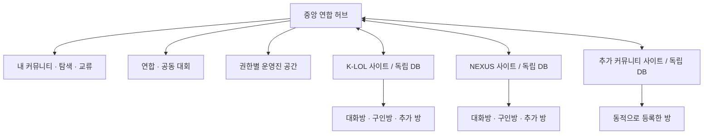

# 커뮤니티 연합 허브 — 요구사항과 구현 설계 초안

작성일: 2026-10-28 (Asia/Seoul)

상태: 최초 요구사항 기록. 2026-10-29 사용자가 설계 선택과 진행을 위임하여 [실행 계획](../community-federation-execution-plan.md)을 확정했다. 사이트·방 메타데이터 관리 모듈을 구현했으며, 독립 중앙 배포·동적 폰 연결·회원 연결·공유 API는 후속 단계다. 아래 내용과 현재 상태가 다르면 실행 계획과 QA 근거를 따른다.

## 1. 사용자 요구사항

- 일반적인 커뮤니티는 대화방과 구인구직방 두 개로 시작하지만, 추가 방을 동적으로 등록할 수 있어야 한다.
- K-LOL, NEXUS와 앞으로 생길 사이트들을 연결하는 별도 중앙 사이트가 필요하다.
- 회원이 가입한 사이트를 한눈에 보고 다른 커뮤니티를 탐색·방문할 수 있어야 한다.
- 회원끼리, 운영진끼리 커뮤니티 경계를 넘어 소통할 수 있어야 한다.
- 커뮤니티·방 단위로 교류전과 대회를 만들고 연합을 구성할 수 있어야 한다.
- 동일한 사람이 여러 커뮤니티에 있을 때 확인 가능한 운영 기록을 권한 있는 운영진이 참고할 수 있어야 한다.
- 데이터는 일괄 통합 또는 일괄 분리로 고정하지 않는다. 기능·정보·참여 범위별로 공유 또는 독립 운영을 선택한다.

## 2. 제품의 기본 구조

중앙 허브는 커뮤니티를 발견하고 연결하는 서비스이며, 각 커뮤니티 사이트는 자기 업무 데이터의 원본을 유지한다. 기존 사이트의 관리자 화면을 중앙에서 쿠키로 대신 조작하지 않는다.

### 개념을 구분한다

| 개념 | 의미 |
| --- | --- |
| 커뮤니티 | 회원·운영 규칙·공유 정책의 주체 |
| 연결 사이트 | 커뮤니티의 주소와 검증된 연결 API. 독립 DB를 유지 |
| 카카오 방 | 명령·알림의 출입구. 표시 이름과 플랫폼 연결 식별값을 분리 |
| 데이터 그룹 | 같은 모집·내전 자료를 사용하는 범위. 방 여러 개가 한 그룹을 사용할 수 있음 |
| 연합 | 초대·수락한 커뮤니티들의 협력 관계. 모든 자료의 공유를 뜻하지 않음 |
| 공동 대회 | 주최자·참가 범위·권한·규칙이 별도로 정해진 행사 |
| 중앙 계정 | 허브 회원. 각 사이트 계정과 별도 검증을 거쳐 연결 |
| 기기 | 실제 메시지를 수신·전송하는 휴대폰. 방별 담당을 명시 |

방의 기본 역할은 대화·구인으로 시작한다. 추가 방은 대회·공지 등 표시 목적을 가질 수 있지만, 실제 권한은 명령 허용 목록·알림 구독·데이터 그룹으로 판정한다. 역할 이름을 새로 추가한다고 관리자 기능이 자동으로 허용되지 않는다. 개수는 코드 상수로 고정하지 않으며, 페이지 조회와 운영상 한도는 별도 설정으로 관리한다.

## 3. 화면과 사용자 흐름

| 공간 | 주요 동작 |
| --- | --- |
| 내 커뮤니티 | 본인이 연결한 사이트·참여 중인 연합·대회·새 알림 확인. 사이트로 이동 |
| 커뮤니티 탐색 | 공개 소개·참여 조건·공개 모집 확인. 승인된 초대 링크로 방문 또는 가입 신청 |
| 교류 공간 | 허용된 범위의 게시글·댓글·교류 요청. 차단·신고·운영 처리 포함 |
| 연합 | 초대 → 상대 수락 → 공동 공간 생성. 참여 범위·자료 공개·탈퇴 처리 |
| 대회 | 주최 커뮤니티/방 선택 → 참여 초대/공개 모집 → 참가 승인 → 일정·대진·결과 |
| 운영진 공간 | 관할 커뮤니티의 연결 상태, 공유 요청, 확인된 운영 기록, 이의 검토 |
| 연결·공유 설정 | 사이트·방 등록, 기기 배정, 기능별 공유 정책, 공개 범위, 연결 해제 |

다른 방 방문은 공개된 소개와 승인된 초대 링크를 통한 이동이다. 비공개 카카오 대화 내용을 수집하거나 중앙 사이트에 복제하지 않는다. 회원의 전체 가입 이력은 기본적으로 본인에게만 보여주고, 공개할 소속은 본인이 선택한다.

## 4. 항목별 통합·분리 정책

공유에는 서로 다른 두 축이 필요하다.

- **보는 사람:** 전체 공개 / 해당 커뮤니티 회원 / 지정 연합 회원 / 지정 운영진 / 소유자·담당자만.
- **할 수 있는 일:** 조회 / 참여 신청 / 댓글 / 관리·수정. 조회 권한이 수정 권한으로 승격되지 않는다.

| 정보 | 제안 기본값 | 선택 가능한 연결 |
| --- | --- | --- |
| 사이트 소개·참여 안내 | 운영자가 게시한 내용만 공개 | 중앙 탐색 목록 노출 |
| 내 가입 사이트 | 본인만 | 본인이 선택한 소속 공개 |
| 공개 모집·공지 | 원본의 공개 범위 유지 | 중앙 모아보기, 지정 연합에 노출 |
| 회원·계정 연결 | 본인 확인 후 연결, 비공개 | 서비스 이용에 필요한 최소 식별 정보 |
| 모집 명단·내전 신청 | 커뮤니티·데이터 그룹별 분리 | 명시적으로 참여한 공동 모집/대회에 공유 |
| 전적·랭킹 | 커뮤니티별 기준 유지 | 출처를 붙인 조회. 공동 랭킹은 별도 규칙으로 생성 |
| 교류 게시글 | 작성 시 선택한 공간의 범위 | 공개·연합·운영진 게시판 |
| 대회 참가·결과 | 대회별 참여·공개 정책 | 사이트/방 단위 대표팀, 공동 주최 |
| 운영 기록 요약 | 원본 커뮤니티 담당자만 | 승인된 수신 커뮤니티의 담당 운영진 |
| 증거 원본·미확정 신고 | 원본의 담당 처리자만 | 필요성이 확인된 별도 증거 접근 승인 |

공유 정책은 자료 종류·허용 필드·수신자·목적·유효기간·수정 권한을 포함한다. 변경 이력을 남기고, 만료·철회·정정은 API 응답과 중앙 캐시에 반영한다. 이미 외부에서 열람·보관한 사본을 원격으로 회수했다고 주장하지 않는다.

연합 가입은 자료 공유의 일괄 동의가 아니다. 공개 모집 모아보기, 공동 대회, 운영진 기록 공유를 각각 활성화한다. 원본 사이트와 수신 측이 정한 범위를 모두 만족해야 조회가 허용된다.

## 5. 계정 연결과 운영 기록

### 동일인 확인

- 닉네임·소환사명·태그가 같다는 이유만으로 계정을 합치거나 제재를 승계하지 않는다.
- 사용자가 중앙 계정과 해당 사이트 계정 양쪽에서 인증한 연결을 기준으로 한다. 비밀번호·세션 쿠키를 중앙 사이트에 전달하지 않는다.
- 검증된 원격 계정 식별자는 `(연결 사이트 ID, 원격 subject)`로 관리한다. 표시 이름 변경은 동일인 판정을 바꾸지 않는다.
- 연결 해제·재인증·연결 충돌·계정 복구 절차를 둔다. 기존 커뮤니티의 회원과 플레이어를 중앙 가입 시 자동 이전하지 않는다.
- 중앙 계정을 만들었다고 각 커뮤니티의 가입 승인이나 운영진 권한을 자동 획득하지 않는다.

### 운영진의 판단을 돕는 기록

확인 가능한 행위와 처리 결과를 보여준다. 기록이 없다는 이유로 안전을 보증하거나, 미확인 신고·닉네임 유사도만으로 사람에게 위험 점수를 부여하지 않는다.

- 출처 커뮤니티, 사건 시점, 확인된 사실 요약, 적용한 규칙, 조치 종류·기간, 담당 검토 상태를 구분한다.
- `검토 중 / 확정 / 이의 검토 중 / 정정 / 철회 / 기간 종료` 등 상태를 보존한다. 신고 접수와 확정된 위반을 같은 상태로 표시하지 않는다.
- 수신 운영진은 자신의 관할과 공유 목적에 필요한 요약만 열람한다. 원문 증거는 별도 권한을 확인한다.
- 조회와 변경을 감사 기록에 남긴다. 본인 통지·이의 신청·정정 요청 경로를 제공한다.
- 다른 커뮤니티의 조치는 참고 근거다. 자기 커뮤니티의 자동 추방이나 전체 사이트 일괄 차단으로 이어지지 않는다. 공동 규칙이 필요한 연합은 별도로 정하고 각 조치의 판단 주체를 표시한다.

## 6. 역할과 권한

| 역할 | 범위 |
| --- | --- |
| 일반 회원 | 본인 계정 연결, 허용된 공간 참여, 가입 사이트 조회 |
| 커뮤니티 운영진 | 소속 커뮤니티에 부여받은 권한 |
| 커뮤니티 책임자 | 자기 사이트 연결, 공유 정책, 운영진 권한 부여 |
| 연합 운영자 | 해당 연합의 공동 공간과 합의된 기능 |
| 대회 운영자 | 지정된 대회의 참가·일정·결과 처리 |
| 중앙 플랫폼 관리자 | 연결·서비스 운영. 이 역할만으로 모든 커뮤니티 비공개 증거의 열람 권한을 얻지 않음 |

역할 검사는 서버에서 수행한다. 클라이언트가 보낸 community ID나 역할 이름을 그대로 신뢰하지 않는다. 운영진·연합·대회 권한은 명시적인 소속 관계와 상태를 확인한다. 조회·목록·검색·내보내기에도 동일한 범위를 적용한다.

## 7. 기존 시스템과 연결하는 방식

### 저장소 경계

- 각 기존 사이트: 회원·모집·경기·제재 원본과 자기 인증 설정을 유지한다.
- 중앙 DB: 커뮤니티/사이트 등록, 검증된 계정 연결, 중앙 회원 소속, 연합, 공동 공간·대회, 공유 정책, 공개 projection, 연결 상태와 감사 이력을 보관한다.
- 중앙이 모든 사이트 DB에 직접 접속하지 않는다. 공개 정보 조회와 권한이 필요한 공유는 버전이 있는 연결 API로 수행한다.
- 등록 시 사이트 소유 확인과 양쪽 연결 승인을 거친다. 설정 가능한 원격 주소는 HTTPS origin 검증·리다이렉트 제한·내부망 접근 방지를 적용한다.
- 각 연결은 별도 자격 증명과 허용 기능을 가진다. 커뮤니티 본래 DB 비밀번호, 관리자 비밀번호, 세션 키를 중앙으로 수집하지 않는다.
- 변경 동기화는 원본 ID·revision·출처·공개 정책을 포함하고 멱등 처리한다. 오래된 캐시나 조회 실패를 빈 자료·정상 상태로 표시하지 않는다.

### 카카오 동적 방 연결

1. 커뮤니티·방 역할·데이터 그룹·담당 기기를 선택한다.
2. 만료되는 일회용 연결 코드를 발급한다.
3. 지정 방에서 코드를 수신해 `(기기, Android 사용자, shortcutId 원문)`을 수집한다.
4. 운영자가 실제 방을 확인한 뒤 활성화한다. 다른 커뮤니티·방에 이미 배정된 연결은 자동 덮어쓰지 않는다.
5. 버전·revision·서명·origin·namespace·권한을 검증한 기기 설정을 전달한다. 잘못된 신규 설정은 활성화하지 않는다.
6. 비활성화·기기 교체·연결 해제 시 이전 세션과 권한을 폐기한다.

기본 두 방 템플릿은 입력 편의일 뿐 고정 슬롯이 아니다. 추가 방은 설정 레코드로 관리한다. 회원·모집 공유 범위는 방 개수와 별도로 유지한다.

### 현재 코드에서 반드시 지킬 호환 경계

- R32 라우터는 네 슬롯을 정확히 요구한다. 동적 설정은 별도 버전으로 도입하고 검증 전에 현재 기기 설정을 대체하지 않는다.
- V4 명령은 정해진 필드 집합만 받는다. 기존 body에 새 필드를 추가하지 않고 opt-in 새 계약에서 `bindingId`를 서명·검증한다. 서버가 해당 연결의 커뮤니티·데이터 그룹·허용 기능을 조회한다.
- 기존 V4 `RECRUIT/FEATURES` 저장 scope는 이행 별칭으로 보존한다. 새 방을 위해 기존 모집 자료를 자동 이동·병합하지 않는다.
- 기존 레거시 `/admin/kakao/rooms`는 V2/V3 전용이다. 화면의 pairing·revision·감사 패턴을 재사용할 수 있으나, 해당 테이블 수정만으로 현재 R32/V4 연결이 바뀌지는 않는다.
- 사이트 알림은 현재 target 하나와 폰 session 하나다. 여러 수신방을 위해 이벤트와 대상별 delivery를 분리하고, 대상별 lease·ACK·실패 상태를 둔다.
- 여러 휴대폰은 우선 방별 단일 담당으로 운영한다. 재시작·담당 변경에도 중복이 생기지 않도록 안정적인 이벤트 ID와 서버 멱등 처리를 사용한다.
- 기존 `PREPARED/SENT/UNCERTAIN` 의미를 유지한다. 전송 성공이 불명확한 상태를 무조건 재시도하거나 실제 카카오 수신 확인으로 표시하지 않는다.

## 8. 재사용할 구현

| 기존 위치 | 재사용할 부분 |
| --- | --- |
| `src/modules/auth` | 로컬 계정·세션 검증과 서버 권한 경계. 커뮤니티별 역할은 별도 확장 |
| `src/modules/operations` | 사이트 설정·운영 상태 관리 패턴 |
| `src/modules/recruiting/kakao-access` | pairing, 일회용·만료 검증, revision과 감사 처리 |
| `src/modules/recruiting/kakao-v4` | 서명·nonce·receipt·기존 설치 scope 호환 |
| `integrations/messengerbot-r/room-routing` | 실제 알림 식별·고정된 답장 대상·직렬 처리·stop 처리 |
| `src/modules/seasons/kakao-site-notices` | 알림 outbox·lease·ACK와 전송 상태 |
| `src/modules/competitions/core` | 대회 상태 전이와 공통 도메인 규칙 |
| `src/modules/competitions/destruction` | 대진·결과 수정 등 기존 대회 기능. 연합 참가 자격과 분리 |
| `src/platform/db/schema/discipline.ts` | 원본 운영 기록 참조. identityKey·닉네임을 사이트 간 동일인 키로 재사용하지 않음 |
| `src/components/ui` | 입력·탭·상태·접근성 공통 요소 |

## 9. 단계별 완료 기준

단계는 기능을 빼는 목록이 아니라 운영 중인 두 사이트를 유지하면서 검증할 순서다. 각 단계는 필요한 DB·권한·HTTP·브라우저 검증과 실제 외부 연결 확인을 별도로 기록한다.

### 1차: 중앙 연결과 동적 방의 기반

- 중앙 회원·커뮤니티별 역할, 사이트 등록/검증/해제, 내 커뮤니티와 공개 탐색.
- 사이트별 독립 DB 유지, 공개 정보에 대한 연결 API, 마지막 확인 시각과 실패 상태.
- 개수 고정이 없는 방 등록·데이터 그룹·기기 배정·공개 범위 설정.
- 새 테스트 방 하나에서 새 연결 계약을 검증한 뒤 기존 네 방을 하나씩 이행.
- 기존 R32/V4는 검증된 이행 전까지 운영하고 복구 가능한 설치본을 보존.

### 2차: 회원 교류·연합·공동 대회

- 양쪽 인증을 거친 계정 연결, 참여 승인, 게시글·댓글·교류 요청.
- 연합 초대·수락·탈퇴, 기능별 공유 동의, 공동 공간 권한.
- 커뮤니티·방 대표팀, 중복 소속 선수 처리, 참가 자격, 공동 운영 권한, 일정·대진·결과.
- 공동 대회 결과가 각 사이트 순위/MMR에 반영되는지는 대회별 합의와 검증을 거쳐 별도로 처리.

### 3차: 운영진 간 기록 공유와 복구 강화

- 확인된 계정 연결에 따른 제한 조회, 공유 요청·승인·기간·철회, 출처/정정/이의 상태.
- 증거 접근 분리, 조회 감사, 정정 전파, 탈퇴/연결 해제 처리.
- 대상별 다중 알림, 세션 재연결, 장애 감지, 기기 교체, 중복·불명확 전송 처리 검증.

## 10. 필수 검증 시나리오

1. 대화·구인 기본 방 외에 세 번째·열 번째 방을 추가해도 코드의 슬롯 상수를 수정하지 않는다.
2. 잘못된 신규 방 연결을 거부하며 기존 유효한 운영 설정을 손상시키지 않는다.
3. K-LOL과 NEXUS의 동일한 명령이 다른 사이트 DB에 저장되지 않는다.
4. 같은 사이트에서 같은 데이터 그룹의 방만 모집을 공유하고 웹 신청도 동일한 규칙을 따른다.
5. 같은 닉네임의 별도 계정을 자동 병합하지 않는다. 한 사이트 인증만으로 다른 계정 연결을 승인하지 않는다.
6. 연합 초대 수락만으로 회원 명단·증거·제재 기록이 공개되지 않는다.
7. 운영진 A가 관할 밖 커뮤니티의 비공개 기록을 ID 변경·검색·내보내기로 조회할 수 없다.
8. 동일한 자료라도 공개 요약과 운영진 요약에 허용된 필드만 반환한다.
9. 회원이 탈퇴하거나 공유가 만료·철회되면 새 요청과 캐시에서 접근을 차단한다.
10. 공동 대회에서 한 사람이 여러 커뮤니티에 소속돼도 정해진 출전 규칙과 확인된 계정 연결에 따라 중복 출전을 처리한다.
11. 두 알림방에 같은 이벤트를 각각 전송해도 서로의 전송 기록이 충돌하지 않는다.
12. 휴대폰 재시작·교체·통신 실패에도 다른 방으로 답장하거나 불확실한 메시지를 반복 발송하지 않는다.
13. 미확정 신고·이의 검토·정정·철회 상태가 확정된 위반이나 안전 보증으로 표시되지 않는다.
14. 중앙 장애 중에도 각 기존 사이트의 독립 운영이 유지되고, 중앙에는 오래된 정보임을 표시한다.

## 11. 아직 결정하지 않은 사항

- 중앙 사이트 이름·주소·시각 디자인.
- 기존 계정의 연결을 넘는 통합 로그인 제공 시점. 가입 사이트를 모아보는 것과 통합 로그인을 구분한다.
- 중앙 계정·커뮤니티 책임자의 최초 등록 방법과 연결 소유 확인 UX.
- 공동 대회에서 출전 소속·참가 자격·MMR/랭킹 비교·결과 반영 규칙.
- 운영 기록의 항목별 보존·공유 기간과 운영 주체의 검토 절차.
- 각 사이트가 중앙에 게시할 공개 소개와 승인된 카카오 초대 링크.

이 항목은 필요한 화면과 계약을 구체화하면서 결정한다. 미정인 값을 실제 연결·공유 동의·운영 권한으로 간주하지 않는다.
