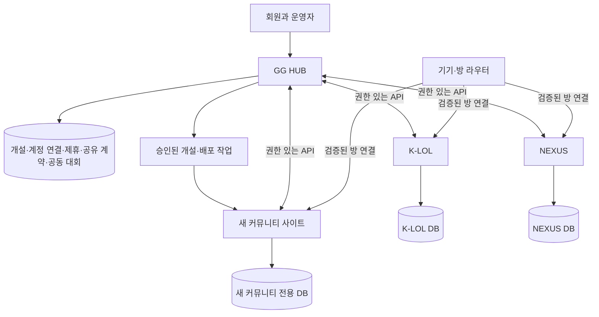

# GG HUB 제품 기획 v1 — 사이트 개설과 커뮤니티 협력

작성일: 2026-10-29 · 상태: 제품 기획 기준안. 이 문서의 신규 기능은 구현·배포 완료를 뜻하지 않는다.

## 1. 만들 제품과 확정된 정책

**GG HUB는 운영자가 자기 커뮤니티 사이트를 개설하고, 회원이 여러 커뮤니티에 참여하며, 커뮤니티들이 합의한 범위에서 모집·행사·대회·운영 정보를 함께 사용하는 플랫폼이다.** K-LOL과 NEXUS는 이 플랫폼에 연결되는 독립 커뮤니티다. 앞으로 개설되는 사이트도 같은 단위로 관리한다.

사용자가 이번에 확정한 정책은 다음 두 가지다.

1. **누구나 개설 신청 → GG HUB 운영자 승인 → 사이트 개설.**
2. **밴·경고 등 운영 기록의 기본 공유 대상은 서로 제휴에 합의한 커뮤니티의 지정 운영진.** 실제 정보 공개에는 별도의 공유 항목·권한 설정이 필요하다.

그 밖의 아래 기본값은 기존 요구와 현재 코드를 바탕으로 선택한 설계안이다. 구현 중 변경이 필요하면 근거와 영향 범위를 남긴다.

| 항목 | 설계 기준 |
|---|---|
| 새 사이트 | 빈 회원·모집·경기 데이터로 시작. 설정·규칙 초안만 제공 |
| 사이트별 정체성 | 이름·로고·마스코트·테마·메뉴·기능·가입 정책·운영진을 별도로 설정 |
| 테마 | 공통 기능을 사용하는 3개 템플릿. 사이트 생성 후에도 변경 가능 |
| 방 | 대화방과 구인구직방을 기본 구성으로 제안. 공지·대회·추가 대화방 등 N개 지원 |
| 회원 | GG 계정과 각 커뮤니티의 회원 자격·역할을 분리. 기존 계정은 양쪽 로그인으로 연결 |
| 데이터 | 각 사이트의 업무 원본은 해당 사이트 소유. 공유는 항목별 선택 |
| 협력 | 제휴, 여러 커뮤니티의 연합, 실제 자료 접근 권한을 구분 |
| 공동 대회 | 주최자들이 같은 규칙 버전에 합의한 뒤 모집·진행·결과 확정 |
| 운영 기록 | 출처와 검토·조치·이의 상태를 보여주고, 각 커뮤니티가 자기 조치를 결정 |
| 초기 운영 구조 | 공통 소스 한 벌, 사이트별 배포와 전용 DB. 중앙 HUB는 별도 DB 사용 |

### 성공을 판단할 실제 사용 장면

새 운영자가 GG HUB에서 사이트를 신청한다. 승인 후 테마가 적용된 실제 사이트에 로그인하고 회원을 받는다. NEXUS에 제휴를 제안하고, 양쪽이 모집 공유에 동의한다. NEXUS 회원이 새 사이트의 모집에 참여하고 취소할 수 있다. 두 운영진은 대회 조건을 협의해 공동 대회를 열고 결과를 확정한다. 필요한 경우 지정된 담당자만 해당 참가자에게 연결된 공유 운영 기록을 보고, 정정·이의 처리 결과도 받는다.

**이 흐름이 실제로 이어져야 제품이 완성된다. 사이트 링크 추가나 관리자 버튼 추가만으로 완료 처리하지 않는다.**

## 2. 현재 구현과 새로 필요한 기능

현재 [GG HUB](https://gg-community-hub.vercel.app)는 독립 배포·DB·관리자 인증과 사이트/방 등록 목록을 갖추었다. 등록된 두 사이트와 네 방은 메타데이터다. 실제 계정 연결, 사이트 자동 생성, 제휴 자료 교환은 구현되지 않았다. 배포 근거는 [기존 QA](../qa-evidence/gg-hub-2026-10-29/README.md)를 따른다.

| 영역 | 확인된 현재 상태 | 이번 제품에 필요한 변화 |
|---|---|---|
| 사이트 등록 | 최고 관리자가 이름·주소·방 목록 저장 | 신청자 계정, 심사, 자원 생성, 소유자 인계, 실제 개설 |
| 브랜드 | `klol / nexus / hub` 빌드타임 분기 | 서비스 종류와 커뮤니티 설정 분리, 새 사이트마다 코드 수정 제거 |
| 디자인 | 기존 K-LOL/NEXUS 화면 | 테마 3개, 설정 편집, 미리보기·게시·복원 |
| 관리 권한 | 최고 관리자의 전체 등록부 수정 | 자기 커뮤니티 범위의 소유자·운영진 권한 |
| 회원 | 사이트별 로그인·회원 | 중앙 계정, 확인된 기존 계정 연결, 내 가입 사이트 |
| 공유 | 공개 소개 링크 | 연결 인증, 공유 계약, 조회·참여·철회·정정 전파 |
| 대회 | 각 사이트 내부 기능 | 공동 제안·합의, 대표 소속, 대회 원본, 공동 결과 확정 |
| 운영 기록 | 사이트 내부 징계와 집계 | 사건 검토·요약 공개·이의 처리·지정 담당자 조회 |
| 카카오톡 | 기존 네 방의 설치·고유 ID 연결 | 새 사이트/방을 설정으로 추가, 기기 상태·설정 적용 확인 |

현재 코드의 `UNVERIFIED` / `NOT_APPLIED` 상태를 실제 연결 성공 없이 바꾸지 않는다. 기존 등록 개수 제한은 서비스 처리 용량이나 공급자 제공 한도를 뜻하지 않는다.

## 3. 이용자와 화면 구조

### 일반 회원

주요 메뉴는 **내 커뮤니티 / 커뮤니티 찾기 / 함께 모집 / 대회·일정 / 알림 / 내 계정**이다.

- 내 커뮤니티: 가입 승인 대기·활동 중·이용 제한·탈퇴 상태, 사이트별 닉네임과 역할. 즐겨찾기와 실제 가입은 구별한다.
- 커뮤니티 찾기: 게임, 활동 시간대, 가입 방식, 모집 유형, 소개로 탐색하고 방문·가입 신청한다.
- 함께 모집: 접근 가능한 제휴 모집을 조회하고 참여·취소한다. 원본 커뮤니티와 외부 참가 조건을 표시한다.
- 대회·일정: 참가 신청, 체크인, 일정 변경, 결과 확인, 이의 제기.
- 내 계정: 연결된 계정, 소속 공개 설정, 내게 적용된 조치와 이의 처리 창구, 연결 해제.

### 커뮤니티 운영자

주요 메뉴는 **운영 홈 / 사이트 꾸미기 / 회원·역할 / 방·봇 / 제휴·연합 / 공유 관리 / 대회 / 운영 기록**이다.

운영 홈은 승인 대기 회원, 모집 마감, 제휴 요청, 확인할 대회 변경, 이의 처리, 봇 연결 이상 등 행동이 필요한 항목을 우선 보여준다. 자료를 읽을 권한과 공유·확정할 권한은 별도로 둔다.

### GG HUB 운영자

주요 메뉴는 **개설 신청 / 사이트 운영 현황 / 배포·복구 / 연결 상태 / 서비스 정책 / 감사 기록**이다. 승인·보완 요청, 자원 한도, 버전, 실패한 작업, 소유권 이전을 관리한다. 모든 사이트의 비공개 사건 증거를 기본 열람하는 역할로 만들지 않는다.

| 역할 | 주요 권한 | 범위 |
|---|---|---|
| GG HUB 운영자 | 개설·플랫폼 이용·자원·서비스 장애 관리 | 플랫폼 |
| 커뮤니티 소유자 | 자기 사이트 설정·운영진·제휴·공유 정책 승인 | 해당 커뮤니티 |
| 커뮤니티 운영진 | 위임받은 회원·모집·운영 업무 | 해당 커뮤니티의 지정 업무 |
| 기록 담당자 | 사건 검토, 허용된 외부 요약 조회, 증거 요청 | 지정된 커뮤니티·사건 |
| 공동 주최자 | 합의된 대회 운영, 변경 승인 | 해당 대회 |
| 심판·진행자 | 경기 결과·이의 처리 등 지정 업무 | 지정 대회·경기 |
| 회원·외부 참가자 | 가입 상태와 모집/대회 조건에 따른 참여 | 허용된 커뮤니티·행사 |

같은 사람이 여러 역할을 가질 수 있다. 화면에는 현재 작업 중인 커뮤니티와 역할을 항상 표시한다. 신규 소유자에게 현재 HUB의 전체 `SUPER_ADMIN` 권한을 주는 방식은 사용하지 않는다.

## 4. 사이트 신청부터 실제 개설까지

### 새 사이트 만들기

1. GG 계정으로 로그인하고 운영자 연락 수단을 확인한다.
2. 커뮤니티 이름, 소개, 희망 주소, 게임·활동 유형을 입력한다.
3. 3개 템플릿 중 하나를 고르고 로고·색상·홈 구성을 미리 본다.
4. 사용할 기능과 가입 방식을 고른다. 기본 방 구성은 대화/구인 2개이며 추가·제외가 가능하다.
5. 신청서를 제출한다. 신청자는 진행 상태와 보완 요청을 확인하고 제출 전·심사 중 취소할 수 있다.
6. GG HUB 운영자가 운영자, 중복 신청, 사이트 목적, 자원 한도를 확인해 승인·보완·반려한다. 반려 사유와 재신청 경로를 제공한다.
7. 승인된 작업이 전용 DB 생성, 빈 스키마 적용, 기본 설정, 배포, 소유권 연결, 상태 점검을 차례로 수행한다.
8. 소유자가 첫 로그인으로 규칙·가입 정책·공개 내용을 확인한다. 기능 검증 후 공개한다.

상태는 `초안 → 제출 → 보완/심사 → 승인 → 개설 중 → 소유자 확인 대기 → 운영 중`으로 보인다. 반려·신청 취소·개설 실패는 별도 상태다. 실패 시 완료된 단계부터 재개하고 진행 중인 동일 신청을 중복 실행하지 않는다.

‘승인’은 사이트 운영에 대한 플랫폼의 승인이다. 다른 커뮤니티와의 제휴나 신뢰 등급을 대신하지 않는다. ‘방 생성’은 사이트의 연결 설정을 준비한다는 의미이며, 실제 카카오톡 방을 자동 개설했다는 의미가 아니다.

### 개설 완료 기준

- 실제 주소에 접속해 선택한 테마와 커뮤니티명이 표시된다.
- 소유자가 자기 커뮤니티의 관리자 기능에 접근하고 다른 커뮤니티에는 접근하지 못한다.
- 새 회원이 가입하고 첫 모집을 만들고 참여할 수 있다.
- K-LOL/NEXUS의 회원·경기·제재가 새 DB에 복제되지 않는다.
- 생성 중 실패와 재시도를 실행해도 프로젝트·DB·소유자가 중복되지 않는다.
- 서비스 버전, DB 대상 확인, 백업/복구 경로, 소유자 연락 수단이 운영 화면에 기록된다.

### 기존 사이트 연결

K-LOL/NEXUS는 사이트를 다시 만들지 않고 **기존 사이트 연결** 흐름을 사용한다. 사이트 소유자가 로그인과 일회성 연결 요청으로 소유권을 증명하고, 연결 모듈을 설치·승인한다. 지원 기능과 버전을 확인한 뒤 공유 범위를 선택한다. 임의 외부 사이트는 주소만 입력해서 완전 연동되는 것으로 취급하지 않는다.

초기 지원은 이 저장소의 공통 엔진을 사용하는 사이트다. 다른 엔진은 공개된 연결 규약을 구현한 경우에만 인증된 기능을 사용한다. 소개 링크만 있는 사이트에는 ‘소개 등록’, 실제 연결 성공한 사이트에는 ‘연결됨’을 구별해 표시한다.

## 5. 커스텀 테마 3개

| 템플릿 | 주요 용도 | 기본 홈 순서 | 표현 |
|---|---|---|---|
| **Arena · 아레나** | 내전·모집·경쟁 중심 | 진행할 경기 → 모집 → 일정 → 결과·랭킹 | 선명한 대비, 점수·진행 상태가 잘 보이는 경기 카드 |
| **Lounge · 라운지** | 친목·마스코트·모임 중심 | 마스코트·소개 → 소식 → 모집·모임 → 활동 사진 | 큰 이미지, 친근한 카드, 브랜드 색상. NEXUS 적용 후보 |
| **Club · 클럽** | 공지·운영·정보 중심 | 중요 공지 → 일정 → 모집 목록 → 이용 안내 | 목록과 캘린더 중심, 정보 밀도·가독성 우선 |

세 템플릿 모두 모집·대회·회원·운영 기능을 사용할 수 있다. 테마 선택 때문에 데이터 구조나 권한이 달라지지 않는다.

**편집 가능한 것:** 이름/로고/배너/마스코트, 제공된 색상·서체·밀도 옵션, 홈 블록 순서·노출, 메뉴 이름·순서, 소개/규칙, 활성 기능, 커뮤니티 링크. 모바일에서도 미리 본다.

**편집 흐름:** 초안 저장 → PC/모바일 미리보기 → 게시 → 이전 게시본으로 복원. 테마 변경은 회원·경기·모집 데이터를 유지한다. 업로드 파일 형식·크기, 이미지 대체 텍스트, 색 대비를 검증한다. 첫 버전은 임의 JavaScript/HTML을 실행하는 사이트 편집기를 포함하지 않는다.

공통 기능 묶음은 회원/공지/모집을 기본으로 하고, 내전·대회/랭킹/미디어/외부 게임 API/카카오 연결을 선택하게 한다. 비활성화한 기능의 기록은 바로 삭제하지 않으며 기존 신청·진행 중 경기 처리부터 안내한다. 외부 API 자격증명이 없는 사이트도 기본 커뮤니티 기능을 사용할 수 있다.

초기 게임 기능은 현재 LoL 엔진을 재사용한다. 소개에서 다른 게임을 언급할 수 있어도 그 게임의 전적·밸런스 엔진을 지원한다고 표시하지 않는다. 다른 게임의 전용 기능은 별도 범위다.

## 6. 계정·소속·방문

GG 계정은 여러 커뮤니티에서 사용할 로그인 주체다. 해당 커뮤니티의 가입 승인과 회원 등급은 각 사이트가 결정한다. 사이트 방문·제휴 참여·모집의 외부 참가가 자동으로 정회원 가입을 뜻하지 않는다.

- 신규 사이트는 GG 로그인과 커뮤니티별 회원 가입을 연결한다. 같은 계정도 A에서는 운영자, B에서는 일반 회원일 수 있다.
- 기존 계정은 GG 로그인과 원본 사이트 로그인 모두 확인한 뒤 연결한다. 비밀번호를 복사하지 않는다.
- 같은 닉네임·Riot ID·프로필 사진만으로 기존 회원을 자동 병합하지 않는다. 게임 계정 확인도 자연인 한 명임을 보장하지 않는다.
- 회원 자격·제재의 원본은 해당 사이트다. HUB의 ‘내 커뮤니티’는 확인 시점과 연결 상태가 있는 요약이다.
- 회원 목록의 대량 공개는 기본값이 아니다. 개인의 소속은 본인이 선택한 범위와 대회 참가에 필요한 범위에서 표시한다.
- 탈퇴·계정 연결 해제·커뮤니티 추방·플랫폼 이용 제한은 서로 다른 동작이다. 기록 처리와 이의 창구도 해당 범위에 맞게 제공한다.

계정 연결 해제는 새로운 사이트 간 동일 계정 조회를 즉시 중단한다. 이미 확정된 대회 엔트리·처리 중인 이의 건에는 당시 확인한 연결 스냅샷을 해당 목적과 보관 기간 안에서만 유지한다. 해제로 원본 사이트의 조치를 삭제하거나 외부 추적을 계속 허용하지 않는다. 재연결은 양쪽 계정을 다시 확인한다.

신규 사이트의 로그인 연결은 사이트 대상이 지정된 짧은 일회성 코드 교환으로 설계한다. 기존 사이트는 전환 중 자체 로그인을 유지한다. HUB 장애 시 이미 유효한 로컬 세션의 로컬 업무는 가능하게 하고, 새로운 중앙 로그인과 사이트 간 작업에는 장애 상태를 안내한다.

## 7. 제휴·연합·공유의 구분

| 개념 | 의미 | 예 |
|---|---|---|
| 제휴 | 두 커뮤니티가 협력 관계에 합의 | NEXUS와 새 커뮤니티가 제휴 수락 |
| 연합 | 여러 커뮤니티가 함께 쓰는 협력 공간 | 4개 방 연합의 일정·공지·대회 |
| 공유 권한 | 어떤 자료를 누가 어떻게 사용할지 정한 허가 | 제휴 A의 모집은 B 회원이 읽고 신청 가능 |

제휴 상태는 `제안 → 협의 → 수락 → 유지 → 중단/해지`다. 제안에는 목적과 원하는 협력 항목을 적는다. 연합에는 가입·탈퇴·대표자·의사결정 규칙을 둔다. 연합에 새 커뮤니티가 들어와도 기존 비공개 자료 접근권을 자동 부여하지 않는다.

공유 설정은 **보내는 커뮤니티 / 받는 커뮤니티 또는 승인된 대상 목록 / 자료 종류·필드 / 대상 역할 / 허용 행동 / 목적 / 만료·철회 조건 / 승인자와 버전**을 가진다. 양방향 제휴여도 자료 공유는 한쪽 방향만 가능하다.

운영자에게는 ‘지금 외부에 공유 중인 것’과 ‘외부에서 받는 것’을 따로 보여준다. 미리보기에서 실제 상대가 보게 될 필드를 확인한다. 범위 확대는 새 동의 버전으로 승인하고, 축소·철회는 즉시 적용한다. A→B 허가가 B→C 재공유 허가로 이어지지 않는다.

비공개 자료 공유는 발신 측 공개 승인과 수신 측 책임자의 목적·조건 수락을 기록한다. 공유 허가 버전, 원본 기록 버전, 외부 요약 버전을 연결해 승인한 내용이 무엇인지 확인할 수 있게 한다. 사유·증거 추가나 대상 확대는 해당 공개 검토·승인을 갱신해야 한다. 취소·철회·정보 축소는 재승인을 기다리지 않고 적용한다.

### 공유할 가치가 있는 정보

| 정보·기능 | 기본 보임 범위 | 실제 공동 사용 |
|---|---|---|
| 소개·활동 시간·가입 조건 | 운영자가 공개 선택 | 커뮤니티 탐색과 가입 신청 |
| 모집·부족 포지션·마감 | 원본 커뮤니티. 공유 시 대상 회원 | 제휴 인원 신청·취소·충원 알림 |
| 행사·캘린더 | 행사별 선택 | 일정 구독·참가·충돌 확인 |
| 연습 경기·교류 제안 | 대상 운영진 | 상대 모집·조건 협의·일정 확정 |
| 공동 대회 | 참가자/운영자/관람자별 구분 | 공동 모집·대진·결과·이의 처리 |
| 운영 규칙·안내문·체크리스트 | 선택된 운영진 또는 공개 | 템플릿 복사·출처 확인·변경 공유 |
| 심판·진행·중계 지원 요청 | 제휴 운영진/지원자 | 필요한 인원과 시간 공개·지원 수락 |
| 소식·하이라이트·사진 | 작성자가 선택하고 게시 권한 확인 | 연합 피드·공동 홍보 |
| 참여·노쇼·분쟁 기록 | 검토된 업무 목적 범위 | 확정된 사건 요약 검토. 추정 점수 공개 없음 |
| 경고·밴 조치 요약 | 제휴한 지정 기록 담당자 | 관계 있는 신청자·회원·참가자에 대해 조회 |
| 사건 증거·내부 메모 | 원본 사건 담당자 | 별도 요청·승인한 증거만 제한 열람 |

운영 공지·공동 일정·인력 요청도 협력 기능으로 포함한다. 밴 조회만을 제휴의 중심으로 만들지 않는다.

### 공동 모집의 정확한 동작

모집 원본과 잔여 자리는 한 사이트에서 관리한다. HUB와 제휴 사이트는 그 모집을 공유해 보여주고, 신청·취소는 원본에 전달한다. 인원수를 복사한 별도 모집을 만들지 않는다.

외부 참가 허용, 대상 커뮤니티, 신청 승인 방식, 연락 정보 전달 범위를 모집에 표시한다. 외부 참가를 허용하지 않은 모집은 HUB에서 클릭해도 가입 조건을 우회하지 못한다. 동시 마지막 자리 신청은 원본 트랜잭션으로 결정하고, 재시도 요청은 같은 신청 결과를 돌려준다. 원본에 연결할 수 없으면 ‘신청 확인 필요/연결 실패’를 보여주며 임의로 참가 완료 처리하지 않는다.

## 8. 공유된 운영 기록

운영자가 필요한 판단을 할 수 있도록 **누가, 어떤 사건을 검토하고, 어떤 조치를 했으며, 현재 유효한지**를 제공한다. 제품 명칭은 ‘공유된 운영 기록’으로 한다.

### 조회 조건과 화면

- 자기 커뮤니티의 가입 신청자·회원 또는 담당 대회 참가자를 검토하는 업무에서 조회한다.
- 원본 사건의 대상 계정과 조회 대상의 확인된 계정 연결이 있어야 동일 계정 기록으로 표시한다. 이름 유사성은 동일인 판정에 사용하지 않는다.
- 제휴, 유효한 공유 허가, 현재 담당자 역할, 조회 목적을 매 요청에서 검사한다.
- 결과 카드는 출처 커뮤니티, 사건 종류, 조치 종류·범위, 사건/검토/만료 날짜, 정리된 사유, 이의 상태, 마지막 갱신, 문의 창구를 보여준다.
- 조회 결과는 ‘공유된 기록 없음’, ‘계정 연결 미확인’, ‘조회 권한 없음’, ‘원본 연결 실패’를 구별한다. 어느 것도 사람에 대한 안전 보증으로 바꾸지 않는다.

### 기록 상태는 네 축으로 관리

| 축 | 상태 예 |
|---|---|
| 사건 검토 | 접수, 검토 중, 확인, 기각 |
| 조치 | 예정, 적용 중, 만료, 해제, 취소 |
| 이의 처리 | 없음, 접수, 재검토, 인용, 기각 |
| 외부 공유 | 비공개, 공개 검토, 지정 대상 공유 중, 철회 |

이의 제기 중에도 조치가 적용 중일 수 있으므로 하나의 상태 값으로 합치지 않는다. 공유 대상에는 네 상태를 함께 제공한다.

조치 종료일, 공유 허가 만료일, 자료 보관 종료일을 별도 관리한다. 조치가 끝나면 현재 제재 목록에서 제외하고 과거 기록은 별도 허가·기간에 따라서만 조회한다. 공유가 만료되면 요약 본문·증거 접근을 차단한다. 보관 종료 시 원문은 삭제하고 필요한 최소 감사 정보만 정해진 정책에 따라 남긴다.

### 작성·공유·정정 흐름

1. 원본 사이트에서 사건을 접수하고 검토한다. 미확인 신고는 원본 담당자 범위에 남는다.
2. 사실 요약과 조치 사유를 작성하고 불필요한 연락처·제보자 정보·대화 내용을 제외한다.
3. 외부 공유는 작성자 외 지정 검토자가 확인한다. 소규모 팀은 선택한 사건의 중앙 검토를 요청할 수 있다.
4. 공유할 요약과 대상·만료 조건을 선택한다. 증거 원문 권한은 별도다.
5. 당사자는 자신의 조치와 이의 경로를 확인한다. 제보자 신원이나 타인의 비공개 자료가 자동 공개되지는 않는다.
6. 정정·취소·만료·이의 결과를 기존 수신처에 전달하고 캐시·대기 알림도 갱신한다. 누가 언제 어떤 목적에서 조회했는지 감사 기록을 남긴다.

같은 사건이 여러 커뮤니티에 전달되어도 원본 사건 ID로 연결해 별도 위반 건수처럼 중복 합산하지 않는다. A의 밴, B의 밴, 플랫폼 이용 제한, 대회 참가 자격은 각각 별도 판단이다. 경고 누적 기준과 해소 조건은 커뮤니티 정책으로 버전 관리한다.

현재 코드의 ‘주의 3회 → 경고’, ‘경고 3회 → 밴 검토’, 해소 기간·경기 수를 모든 사이트의 전역 정책으로 확대하지 않는다. 기존 `direct:이름|닉네임|태그` 식별과 징계 해소 과제 증거를 외부 동일인 확인·사건 심사 증거로 그대로 재사용하지 않는다.

## 9. 서로 합의하는 공동 대회

공동 대회의 원본은 HUB에 둔다. 각 사이트는 자기 참가자의 자격을 확인하고 대회 화면·공지·결과를 연결한다. 한 대회가 두 사이트의 별도 대회로 복제되어 서로 다른 결과를 갖지 않도록 한다.

### 주최자들이 합의할 항목

참여 커뮤니티, 일정·시간대, 경기 방식, 팀·인원 수, 참가 자격, 대표 소속, 중복 출전, 후보/교체, 체크인·노쇼, 팀 편성 방식, 결과 확인자, 분쟁 담당자, 취소 조건, 공개 범위, 비용·상금 유무를 같은 규칙 문서에 담는다. 미정인 항목을 임의의 사실로 채우지 않는다.

대회 유형은 다음 두 가지를 구분한다.

- **대표팀 대항전:** 각 커뮤니티가 팀을 내고 자격·시드·대진을 합의한다. 자동 편성이 상대 팀 명단을 임의로 섞지 않는다.
- **연합 혼합 내전:** 여러 커뮤니티의 참가자를 모아 공통 기준으로 팀을 편성한다. 소속 분산·같이하기 등의 조건을 규칙으로 선택한다.

### 운영 흐름

`제안 → 조건 협의 → 동일 규칙 버전 공동 승인 → 모집 → 명단 확정 → 편성·대진 → 경기 → 결과 확인 → 이의 처리 → 최종 확정`

- 필수 주최자 모두가 같은 버전에 승인해야 모집을 연다. 일정·참가 자격·편성 기준·상금 등 중요한 변경은 기존 승인을 무효화하고 재승인한다.
- 사전에 정한 조건 안의 일상 진행 권한은 담당자에게 위임한다. 모든 점수 입력마다 전체 주최자 승인을 요구하지 않는다.
- 여러 방에 가입한 사람도 한 대회에서는 합의된 대표 소속과 하나의 참가 엔트리를 사용한다. 확인된 계정 연결 범위에서 중복을 막고 미연결 계정은 별도 자격 심사한다.
- 모집 마감 시 참가자·소속·포지션·편성 자료·공식 버전을 고정한다. 교체는 변경 이력과 재검증을 남긴다.
- 결과 제출 → 상대 확인 → 이의 기간 → 최종 확정으로 처리한다. 불일치는 지정 심판에게 전달한다.
- 탈퇴·제휴 해지 때도 진행 중 대회의 정산·결과 확정 책임을 사전에 정한 규칙에 따라 마무리한다.
- 상금·참가비는 첫 버전에서 실제 계획과 외부 처리 현황을 기록한다. 플랫폼의 결제·에스크로 기능은 별도 범위다.

대회 모집 전에 참가 확인·결과·분쟁 처리에 필요한 대회 전용 권한과 종료일을 따로 승인한다. 제휴가 해지되면 새 모집·운영 기록 공유는 즉시 중단하고, 진행 중 대회에는 이 최소 권한만 남긴다. 대회 전용 권한까지 철회하면 기존 자료 접근을 우회해 유지하지 않고 대체 담당자 지정·중단·취소 절차로 전환한다.

### 밸런스·MMR 설계에 미치는 영향

서로 다른 사이트의 MMR 숫자는 곧바로 비교하지 않는다. 초기 공동 대회는 주최자가 합의한 공통 입력 기준과 계산 버전을 사용하고 자료의 출처·시즌·표본·불확실성을 표시한다. 외부 게임 API 접근이 없는 선수는 ‘정보 부족/확인 필요’로 다루며 정상 선수처럼 꾸민 기본 값을 넣지 않는다.

팀 편성은 점수 차이뿐 아니라 포지션, 신규 참가자 표본, 상대 역할 격차, 교체·기권, 수동 조정 사유를 확인할 수 있어야 한다. 팀 평균 하나가 모든 조건을 잘 맞췄다는 의미가 되지 않게 한다. 심판에게는 자격 판정에 필요한 정보만 제공하고 운영 기록 전체를 자동 노출하지 않는다.

**이번 설계에서 공동 경기의 기존 사이트 MMR 반영 기본값은 OFF**다. 반영하려면 모집 전에 대상 경기·원본 ID·공식 버전·중복 처리·정정 규칙을 각 사이트가 따로 승인한다. 재전송으로 점수가 두 번 반영되지 않아야 한다. 이 기본값은 신규 공동 대회 기능에 대한 설계이며 현재 사이트의 로컬 경기 정책을 변경했다는 뜻이 아니다.

기존 밸런스/MMR 검토는 [별도 감사 보고서](../architecture/drafts/balance-mmr-audit-2026-10-29.md)를 따른다. 선수 교체·10명 정원·포지션 정렬 오류 수정과 새 계산식 도입을 구별한다. 차기 공식은 승패/상대 강도/불확실성을 중심으로 과거→미래 검증과 운영 옆 병행 계산을 거친다. 성능 근거 없이 점수를 일괄 재계산하지 않는다.

## 10. 카카오톡 방을 동적으로 늘리기

사용자는 운영 화면에서 방 이름과 목적을 정하고 연결 코드를 받는다. 실제 방에서 코드를 수신하면 기기·플랫폼 방 식별자를 확인해 연결 결과를 보여준다. 같은 휴대폰에 여러 커뮤니티를 연결할 수 있지만 라우팅은 커뮤니티와 방 ID로 분리한다.

- 방은 N개이고 목적은 대화·구인·공지·대회 등을 지정한다. 기본 2개는 빠른 시작 구성이다.
- 식별은 검증된 `기기 설치 ID + Android 사용자 + 플랫폼 방 ID`를 사용한다. 이름은 변경 가능한 표시값이며 큰 정수 방 ID는 문자열로 보존한다.
- 구인 현황을 공유할 방은 같은 커뮤니티 안에서 명시적으로 묶는다. 다른 사이트와 공유하려면 별도 공유 계약이 필요하다.
- 방마다 수신 명령, 자동 알림 종류, 조용한 시간, 발송 빈도, 모집 대상 그룹을 설정한다.
- 새 설정은 버전·서명·만료·대상 기기를 검증하고 한 번에 적용한다. 화면에 마지막 수신, 적용 버전, 세션 상태, 오류를 보여준다.
- `이벤트 ID + 대상 방 ID`로 중복 발송을 막는다. 연결이 끊긴 방을 다른 방으로 대체하지 않는다.
- 기기 교체 시 기존 연결을 철회하고 새 기기에서 연결한다. 같은 방에 두 라우터가 동시에 응답하지 않도록 활성 소유권을 관리한다.

기존 네 방의 정상 동작을 회귀 기준으로 유지하고, 시험 방에서 신규 설정 방식을 검증한 뒤 단계적으로 옮긴다. **3번째·10번째 방 또는 세 번째 사이트 추가 때 봇 전체 코드를 다시 작성하거나 프로필을 복제하지 않는 것**이 완료 조건이다. Android 알림 권한·앱 동작·재연결은 실기기로 검증한다.

## 11. 권장 기술 구조와 데이터 소유권

### 초기 구조 선택

**중앙 HUB DB + 공통 엔진 소스 한 벌 + 커뮤니티별 Vercel 배포와 전용 Neon 프로젝트/DB**로 시작한다. 사이트마다 리포지터리를 포크하지 않는다. 같은 엔진 버전과 사이트 설정을 조합해 배포한다.

현재 `getDatabase()`는 요청별 커뮤니티를 받지 않고 전역 서비스별 연결을 선택한다. 지금 즉시 공통 실행 서버로 바꾸면 전체 repository·캐시·작업·인증의 커뮤니티 경계를 다시 검증해야 한다. 기존 분리 요구와 현재 구현을 고려하면 초기 배포·DB 분리를 유지하는 편이 현실적이다.

| 선택 | 장점 | 비용·한계 | 적용 |
|---|---|---|---|
| 공통 소스, 개별 배포·DB | 현재 코드 재사용, 개별 장애·복구 | 사이트 수만큼 배포/마이그레이션 관리 | 초기 운영 |
| 공통 실행 서버, 개별 DB | 공통 배포, DB 분리 유지 | 요청별 DB·캐시·작업 문맥과 연결 풀 검증 | 운영 비용 증가 시 재검토 |
| 공통 실행 서버·공유 DB | 많은 사이트의 자원 통합 | 모든 접근·FK·복구의 테넌트 격리 재설계 | 별도 구조 결정 |

Vercel은 같은 기능·다른 브랜드의 서비스에 공통 코드 기반 구성을 설명한다. 여기서는 그 원칙을 사용하되 현재 코드의 격리를 보존하기 위해 초기 배포 단위를 분리한다. 이는 공급자의 유일한 권장 구조라는 뜻이 아닌 저장소 상태를 고려한 선택이다. [Vercel 플랫폼 구조](https://vercel.com/for/platforms)

### 자료 원본과 연결

| 자료 | 권위 있는 원본 | 다른 곳에 보관할 수 있는 것 |
|---|---|---|
| GG 계정·연결 동의 | HUB | 대상 사이트용 인증 식별자 |
| 커뮤니티 회원·역할·로컬 밴 | 해당 사이트 | 권한 있는 소속/상태 요약과 갱신 시점 |
| 사이트 신청·배포 작업·제휴·공유 계약 | HUB | 필요한 설정 버전과 허가 확인 |
| 사이트 테마 | 관리 설정의 게시 버전 | 사이트의 검증된 마지막 게시본 |
| 개별 모집·일반 경기·MMR | 해당 사이트 | 허가된 읽기 요약, 원본에 대한 참여 요청 |
| 공동 대회·공동 결과 | HUB | 참여 사이트의 조회 자료와 승인된 결과 수신 |
| 원본 사건·증거 | 원본 커뮤니티 | 승인된 요약, 제한된 증거 열람 결과 |
| 방 라우팅 정책 | HUB 관리 설정 | 대상 기기가 검증·적용한 설정 |

업무 공유는 제한된 API로 하고 HUB가 자식 사이트 업무 DB를 직접 읽는 기능으로 만들지 않는다. 자원 생성·migration에 쓰는 운영 자격증명은 별도 작업 실행 경계에서 사용한다. 브라우저와 일반 관리자 API 응답에 DB URL·provider 토큰을 넣지 않는다.

처음부터 별도 마이크로서비스·메시지 브로커를 전제하지 않는다. 현재 모듈형 앱과 PostgreSQL 작업 큐/outbox를 확장하고, 웹 요청과 분리해 재개 가능한 작업 실행기를 둔다. 운영 비밀값은 서버의 비밀 저장 경계에서만 참조한다.

### 핵심 데이터 개념

`개설 신청`, `커뮤니티`, `사이트 배포`, `소유권`, `테마 게시본`, `회원 자격/계정 연결`, `연결 모듈`, `제휴`, `연합`, `공유 허가`, `공동 대회/규칙 승인`, `외부 공개 사건 요약`, `방/기기/설정 적용 상태`, `작업/감사 기록`을 분리한다. 이는 개념 모델이며 아직 작성되지 않은 DB 테이블이 존재한다고 주장하지 않는다.

## 12. 자동 개설·주소·운영 관리

### 개설 작업의 신뢰성

개설 작업에는 신청 ID, 각 provider의 실제 자원 ID, 완료 단계, 엔진/스키마 버전, 재시도 결과를 저장한다. 같은 신청의 재실행은 기존 자원을 확인해 이어간다. 자원을 만든 뒤 결과 기록이 실패하는 경우도 다음 시도에서 대조할 수 있어야 한다.

개설 전 현재 계정의 프로젝트·빌드·DB·저장량 한도와 예상 자원을 확인한다. 한도 부족은 심사/개설 대기 상태로 알리고 무한 재시도하지 않는다. 취소·실패 시 자원 상태를 운영자에게 보여주되, 사용 데이터가 생긴 DB를 보상 처리로 자동 삭제하지 않는다.

신규 사이트마다 인증 서명 키·DB 대상·연결 자격증명을 분리한다. `communityId`와 기대 DB identity를 배포 manifest와 대조한다. 다른 DB 또는 누락된 DB 설정이면 시작을 거부하며 K-LOL/NEXUS로 기본 연결하지 않는다.

### 주소 정책

초기에는 사용 가능한 `<프로젝트명>.vercel.app` 주소를 발급하고 실제 주소를 저장한다. 희망 slug와 실제 주소는 별도 값이다. 이름 충돌 시 제안된 대체 주소를 신청자가 확인할 수 있게 한다. Vercel의 `.vercel.app` 주소는 선착순 할당이며 예약할 수 없으므로 개설 전 희망 주소를 보장하지 않는다. [Vercel 도메인 문서](https://vercel.com/docs/domains/working-with-domains)

추후 소유 도메인을 확보하면 `<커뮤니티>.<소유 도메인>` 또는 개별 도메인을 연결한다. 기존 Vercel 주소 아래에 임의의 하위 도메인을 제공할 수 있다고 가정하지 않는다. 주소 변경은 사이트 ID·회원·대회 ID를 바꾸지 않고, 소유권 확인과 이전 주소 처리 절차를 거친다.

### 사이트가 늘어났을 때

첫 검증은 기존 두 사이트와 신규 한 사이트로 수행한다. 이후 운영 규모는 실제 자원·지원 여력으로 결정한다. Neon의 프로젝트 수와 자원 한도는 요금제에 따라 달라진다. 이번 계획에서 무료 사이트 수나 무제한 운영을 약속하지 않는다. [Neon 프로젝트 관리](https://neon.com/docs/manage/projects)

운영 화면에는 사이트별 배포 버전·DB 스키마 버전·연결/봇 상태·실패 작업·자원 사용량을 보여준다. 공통 업데이트는 시험 사이트 → 소수 사이트 → 전체 순서로 적용한다. 복구는 사이트별로 할 수 있게 하고, 스키마 변경은 전진 migration과 검증한 복원 경로를 사용한다.

소유권 이전은 기존/새 소유자 확인과 감사 기록을 남긴다. 사이트 휴면·중지·종료는 구별하고 종료 전에 진행 중 모집·대회 처리, 내보내기, 공유 철회를 제공한다. 보관 기간·삭제 처리·연락 책임은 공개 운영 시작 전 서비스 정책으로 확정한다.

## 13. 연결 장애·철회·보안 경계

- 원본 변경과 발송할 이벤트를 같은 트랜잭션으로 저장한다. 수신은 이벤트 ID로 중복을 제거하고 레코드 버전을 비교한다.
- 재시도 횟수와 다음 시도, 마지막 성공을 기록하고 반복 실패는 운영자가 재처리할 수 있게 한다. 백그라운드 실패를 UI 성공으로 숨기지 않는다.
- 자료 수정·삭제·공유 철회도 이벤트다. 기존 캐시와 아직 발송하지 않은 알림에서 철회한 내용이 다시 나오지 않아야 한다.
- 민감한 운영 기록 조회는 현재 공유 허가와 역할을 확인한다. 이를 확인할 수 없으면 비공개 자료 접근을 차단한다.
- 원본 장애는 ‘자료 없음’과 구별한다. 공개 소개처럼 캐시를 보여줄 수 있는 자료는 마지막 확인 시간을 표시한다.
- 연결별 키·권한·대상 사이트·API 버전·유효기간을 관리하고 키 회전/철회를 제공한다. 커뮤니티 소유자에게 provider 전체 관리 토큰을 주지 않는다.
- 외부 주소 등록은 HTTPS·소유권·리다이렉트·내부 네트워크 접근을 검증한다. 브라우저에서 전달한 주소나 커뮤니티 ID만 믿고 서버 요청/권한을 결정하지 않는다.
- 파일·증거는 자료별 권한으로 접근시키고 단순 공개 URL에 두지 않는다. 이미 사람이 확인한 정보를 철회로 회수했다고 표현하지 않는다.
- HUB 장애가 기존 사이트의 로컬 모집·경기·기존 유효 세션을 막지 않도록 한다. 중앙 작업과 새 로그인, 만료된 공유 권한이 필요한 작업은 상태를 안내한다.

## 14. 구현 순서와 실제 완료 조건

각 단계는 화면·서버·권한·데이터·실패 처리를 포함한 하나의 이용 흐름으로 끝낸다. 아래 1~5는 모두 첫 완성 제품의 범위이며, 앞 단계 배포를 전체 완료라고 부르지 않는다.

| 단계 | 결과물 | 검증할 실제 시나리오 |
|---|---|---|
| **1. 개설 가능한 플랫폼** | GG 계정 가입/로그인/복구와 신규 사이트 인증 연결, 커뮤니티별 권한, 동적 브랜드, 테마 3개, 신청/심사, 자동 개설·재개, 소유자 인계 | 세 번째 사이트를 코드 수정 없이 개설. 소유자 로그인→회원 가입→첫 모집. 다른 사이트 DB/관리자 차단 |
| **2. 기존 계정·사이트·방 연결** | 기존 사이트 연결 모듈, K-LOL/NEXUS 계정 연결, 내 커뮤니티 통합 조회, 기기/방 설정 | 기존 로그인을 유지하며 본인 계정 연결. 3/10번째 방 추가 후 해당 사이트만 응답 |
| **3. 제휴와 함께 쓰는 모집** | 제휴 제안/수락, 공유 허가, 연합 공간, 공동 일정/공지, 외부 모집 참여 | 새 사이트↔NEXUS 상호 동의→모집 공유→외부 신청/취소. 마지막 자리 동시 신청·철회·제휴 해지 반영 |
| **4. 함께 여는 대회** | 규칙 제안/수정/공동 승인, 두 대회 유형, 명단·편성·결과·이의 | 두 커뮤니티 친선 대회를 모집부터 결과 확정까지 진행. 규칙 변경 재승인·중복 출전·교체·정정 검증 |
| **5. 책임 있는 운영 기록 공유** | 사건 검토/공개 요약, 담당자 접근, 증거 요청, 본인 이의/정정, 조회 감사 | 지정 담당자만 조회. 같은 이름 다른 계정 차단. 공유 철회·해제·담당자 해임·정정이 조회/캐시/알림에 반영 |

공유 허가·감사·철회 구조는 3단계부터 구현해 5단계까지 재사용한다. 기록 공유는 공개 목록이나 원문 유출이 없는지 검증한 뒤 활성화한다. 운영 상태·복구·비용 확인은 각 단계에 포함하고 마지막으로 미루지 않는다.

### 통합 출시 시험

1. 기존 K-LOL/NEXUS 기능과 데이터 보존, 새 사이트가 빈 업무 데이터로 시작하는지 확인한다.
2. 3개 테마의 모바일·키보드·빈 상태·오류 상태, 게시/복원과 데이터 보존을 확인한다.
3. 다른 커뮤니티 ID를 보내는 API 요청, 삭제된 운영진 세션, 만료된 공유 링크의 차단을 확인한다.
4. 같은 닉네임 계정을 자동 연결하지 않고 가입·대회 자격·제재 범위를 구분하는지 확인한다.
5. 개설 중 실패/재시도, 원본 장애, 중복 이벤트, 순서가 바뀐 정정, 동의 철회를 시험한다.
6. 모집 원본의 마지막 자리, 중복 취소, 대회 결과 재전송이 중복 처리되지 않는지 확인한다.
7. 공동 대회 변경 승인과 MMR 기본 미반영, 명시적 반영 시 원본 ID 중복 방지를 확인한다.
8. 기존 네 카카오 방과 새 방을 실기기에서 검증하고 잘못된 사이트 조회·오발송·중복 응답을 확인한다.
9. 배포 후보의 전체 검사와 격리 DB fresh/upgrade, 사이트별 운영 smoke, 복구 절차를 남긴다.

실제 사용자 행동으로는 **신청 → 사이트 개설 → 회원 가입 → 제휴 승인 → 공유 모집 참여 → 공동 대회 완료 → 제한된 기록 열람·정정**을 끝까지 검증한다. 사용자 승인 없이 가상의 실제 대회·제휴·사건 기록을 운영 데이터로 만들지 않는다.

### 운영 중 측정할 지표

개설 성공/실패와 재개 시간, 개설 후 첫 모집까지 걸린 시간, 실제 활동 사이트 수, 제휴 수락 후 공동 행동 비율, 외부 모집 참여/취소 성공률, 대회 완료/분쟁 처리, 공유 철회 전파 시간, 봇 오발송/중복, 사이트당 운영 비용을 측정한다. 단순 등록 사이트 수만으로 플랫폼의 성공을 평가하지 않는다.

## 15. 첫 구현 착수 범위와 별도 결정 사항

다음 구현 단위는 **‘세 번째 커뮤니티를 실제로 만들고 사용할 수 있는 개설 흐름’**이다. GG 계정 가입·로그인·복구와 신규 사이트 대상 일회성 인증 코드 교환부터 포함한다. 전체 관리자 권한을 커뮤니티 소유자 권한으로 나누고, 기존 브랜드 분기를 설정 기반으로 바꾸며, 신청과 복구 가능한 개설 작업을 구현한다. 이때 3개 테마의 실제 홈 구성과 편집·게시까지 함께 검증한다. 기존 K-LOL/NEXUS 계정의 연결·전환은 다음 단계에서 진행한다.

이 기획에 따라 후속 기능은 계속 구현하되, 아래 항목은 해당 운영 작업 전에 실제 조건을 확인한다.

- 공급자 자원 한도·월 운영 예산·비용 부담 주체: 초기에는 GG HUB 관리 계정으로 운영하는 구조를 가정하되 무제한 무료 개설을 약속하지 않는다.
- 소유 도메인: 초기 Vercel 주소로 시작 가능. 유료 도메인 구매는 별도 선택이다.
- 서비스 정책: 개설 심사 기준, 운영 기록의 보관·열람·이의 처리 책임, 사이트 종료/자료 내보내기 절차.
- 외부 게임 연동: 사이트별 승인/키 사용 범위와 계정 확인 기능의 실제 이용 가능 여부. API 조회와 Riot 로그인 소유권 확인을 혼동하지 않는다.

초기 범위에서 제외하는 기능은 임의 코드 실행형 사이트 빌더, 모든 사람의 공개 위험 점수/전역 자동 밴, 검증 전 사이트 통합 MMR, 플랫폼 자체 결제/상금 보관이다. 핵심 이용 흐름과 격리를 검증한 다음 각각의 필요성을 별도 판단한다.

## 16. 근거와 문서 관리

- [기존 연합 실행 계획](../architecture/community-federation-execution-plan.md): 독립 원본·선택적 공유 원칙과 이전 구축 이력. 후속 제품 범위와 순서는 이 기획 v1을 따른다.
- [GG HUB 운영 안내](../operations/gg-hub.md), [현재 배포 QA](../qa-evidence/gg-hub-2026-10-29/README.md): 이미 구현·배포된 범위.
- [대회·MMR 감사](../architecture/drafts/balance-mmr-audit-2026-10-29.md): 기존 결함·수정·계산식 평가 계획.
- 코드 확인: `src/lib/service-brand.ts`, `src/platform/db/client.ts`, `src/platform/db/runtime-database-url.ts`, `src/platform/db/schema/community-network.ts`, `src/modules/community-network/domain/community-network.ts`.
- 운영 기록 확인: `src/modules/discipline/domain/policy.ts`, `src/modules/discipline/domain/public-statistics.ts`, `src/platform/db/schema/discipline.ts`. 현재 공개 집계가 이름·사유·증거를 제외하는 경계는 유지한다.
- 공급자 사실은 2026-10-29 공식 문서 확인 기준이다. 프로젝트·요금제 한도는 실제 개설 시 다시 확인한다.

이 문서는 제품 계획이다. 소스 반영·로컬 검증·운영 배포·휴대폰 적용은 각각 증거가 생길 때 `docs/STATUS.md`와 해당 릴리스 QA에 기록한다.
