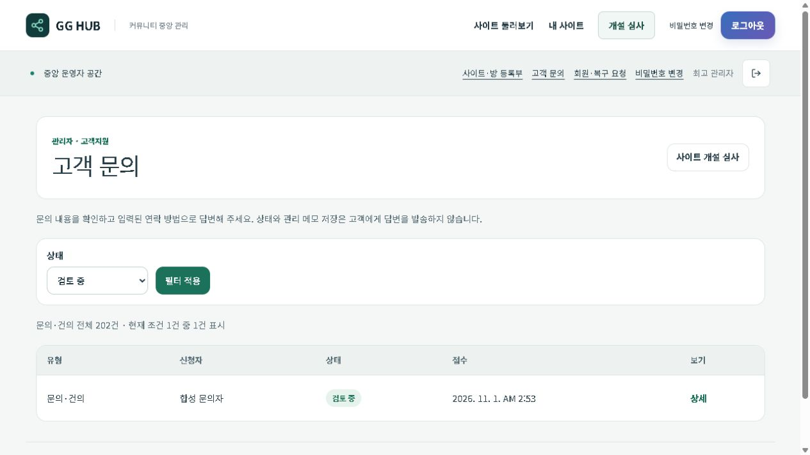

# 고객 문의·운영 시작 안내 1.0.0 검증

기준일: 2026-11-01 KST. [유료 서비스 완성 기준](../../product/gg-hub-commercial-readiness-v1.md)의 첫 작업이다. 소스·로컬 검증과 운영 배포를 구분한다.

## 변경과 보존

HUB 문의 관리의 필터·페이지 이동, 고객 문의 발견 경로, 접수 재시도, 관리자 대비, 소유자의 상태별 다음 행동을 보완했다. 개발 환경에서 인코딩된 대괄호가 있는 Next 정적 청크만 허용하며 운영 모드와 인코딩된 경로 탐색·구분자 차단을 유지한다.

DB 스키마/API 계약·권한·기존 보관 기간·휴대폰 설치본·MMR 산식·정책 동의 버전은 변경하지 않았다. 실제 고객 문의·메일·카카오 메시지를 전송하지 않았다. 신규 과금·결제 제공자 연결·환불 실행·운영 회원 자료 수정도 없다.

## 검증

- 회귀 검사: 불확실한 접수 원문/키 재사용, 같은 렌더 중복 제출, 검증 오류 뒤 수정, HUB 필터·페이지 이동, 기존 커뮤니티 목록 유지, 개설 상태별 안내, 실패한 게시 구분, 개발 정적 청크와 인코딩 우회 차단.
- 격리 loopback PostgreSQL + 실제 HUB HTTP 15개 PASS: Origin·동의·멱등 접수, 익명/회원의 관리자 문의 차단, 관리자 상태 수정·오래된 수정 차단, 201개 합성 대기 문의의 페이지 이동, HUB 경계, 공개 폼, 소유자 페이지·상태 API, 기존 설정 보존.
- 실제 브라우저: 문의 다음 페이지·상태 필터, 소유자 안내, 390px 화면의 가로 넘침 없음, 모바일 문의 제출→접수번호·초점→관리자 목록 확인. 모두 합성 자료다. [결과](browser.json).
- 최종 `npm run check` PASS: lint 오류 0·기존 경고 89, 타입·ERD 126개 테이블/190개 관계, 계약 804개, 단위 1,339개 통과·기존 1개 skip, 이미지 68개, 운영 빌드 99개 정적 페이지. 현재 소스 트리 비밀정보 검사 PASS, 전체 이력 재검사는 미실행.
- 첫 화면 검증에서 HUB의 관리자 색상 변수가 누락된 문제와 개발 청크 차단을 발견해 수정했다. 최종 변경 뒤 전체 검사를 다시 통과했다. 최초 QA 드라이버는 페이지 크기 가정과 클라이언트 렌더를 SSR로 검증한 가정을 수정한 뒤 실제 흐름을 재검증했다.
- 격리 서버 종료 및 고유 합성 DB 정리 완료. [실제 HTTP 결과](local-http.json).

[모바일 운영 시작 안내](owner-mobile.png) · [모바일 문의 접수](support-receipt-mobile.png)

## 배포와 복구

전체 검사 최종 결과와 각 운영 배포는 후속 근거로 기록한다. 아직 이 문서만으로 운영 배포 완료를 주장하지 않는다. migration head `0052_community-introduction` 유지, migration 실행 없음. 이전 세 프로젝트 배포 ID와 개설 엔진 SHA를 기록하고 문제가 생기면 같은 프로젝트의 이전 배포와 엔진 설정으로 복원한다.

유료 출시, 전체 고객지원 대화/자동 답변, 실제 고객 개설·첫 모집 완주, 기존 계정 연결, 동적 폰 연결, 제휴·공동 대회는 별도 미완료 범위다. 과거 릴리스의 확인 창 이탈 테스트를 이번 문의 제출 검사로 대체하지 않는다.
