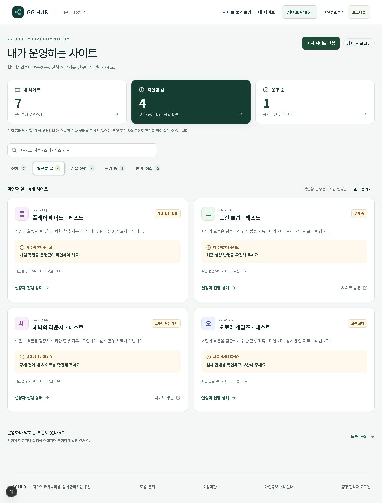

# GG HUB 시작 화면·운영 홈 1.0.0 검증

기준일: 2026-11-01 KST. 운영자가 테마를 고르고 자기 사이트의 다음 행동을 찾는 경험을 개선했다. [변경 안내](../../patch-notes/hub-experience-v1.0.0.md).

## 구현 범위

HUB의 테마 체험, 선택을 보존하는 로그인·신청, 성공한 신청의 관리 주소 이동, 소유자 대시보드·검색·상태 분류·첫 이용자 안내와 모바일 헤더를 보완했다. 기존 설정 미리보기·상태별 안내·API·권한을 재사용한다. 운영 데이터나 schema migration을 변경하지 않는다.

## 검증

- 상태 10종, 실패한 게시와 운영 상태의 공존, 검색 정규화·복수 조건·정렬과 입력 불변성, 테마 선택 전달과 실패 재시도, 성공 후 주소 이동을 검사했다.
- 격리 PostgreSQL·실제 HUB HTTP 19조건 PASS. 기존 문의·관리자·저장 경계 15조건과 세 테마의 인증 복귀 주소·첫 화면 출력을 확인했다.
- 실제 브라우저에서 테마 선택→로그인→같은 테마의 신청→관리 주소 이동→새로고침 복원을 확인했다. 테스트 자료 외의 실제 개설 요청은 만들지 않았다.
- 여러 상태의 합성 사이트에 대해 확인할 일·검색·결과 없음·초기화를 검증했다. 운영 중인 사이트의 게시 실패를 별도로 표시한다.
- 390px 운영 홈·첫 화면과 320px 첫 화면에서 가로 넘침이 없음을 확인했다. 모바일 상태 필터·키보드 방향키 테마 선택을 확인했다.
- 첫 HTTP 검증의 문자열 비교는 React의 텍스트 구분 주석을 고려해 실제 링크 주소로 수정했다. 기존 계약 테스트에는 새 테마 컴포넌트 의존성을 추가했다. 검사를 느슨하게 하거나 기존 권한 검증을 삭제하지 않았다.

최종 `npm run check` PASS: 계약 804개, 단위 1,344개 통과·기존 1개 건너뜀, 타입 검사·ERD·아트 검사·운영 빌드 통과. ESLint 오류 0개, 기존 경고 89개. 브라우저 검증 후 임시 서버를 종료하고 격리 DB를 정리했다. [브라우저 결과](browser.json) · [HTTP 결과](local-http.json). 운영 배포 근거는 배포 후 기록한다.

[모바일 운영 홈](owner-mobile.png) · [모바일 테마 선택](home-mobile.png)

## 배포와 한계

이번 기능의 배포 대상은 GG HUB와 신규 사이트 개설 엔진이다. 기존 K-LOL/NEXUS의 운영 배포와 휴대폰은 교체하지 않는다. 실제 결제, 전체 사업화 요구, 사이트 간 제휴·공동 대회·동적 방 연결의 완료를 의미하지 않는다. 테마 미리보기는 구성 예시이며 실제 회원·모집 실적을 표시하지 않는다.

migration head `0052_community-introduction` 유지. 배포 ID·이전 배포·엔진 SHA와 복구 방법은 최종 운영 검증 후 기록한다.
